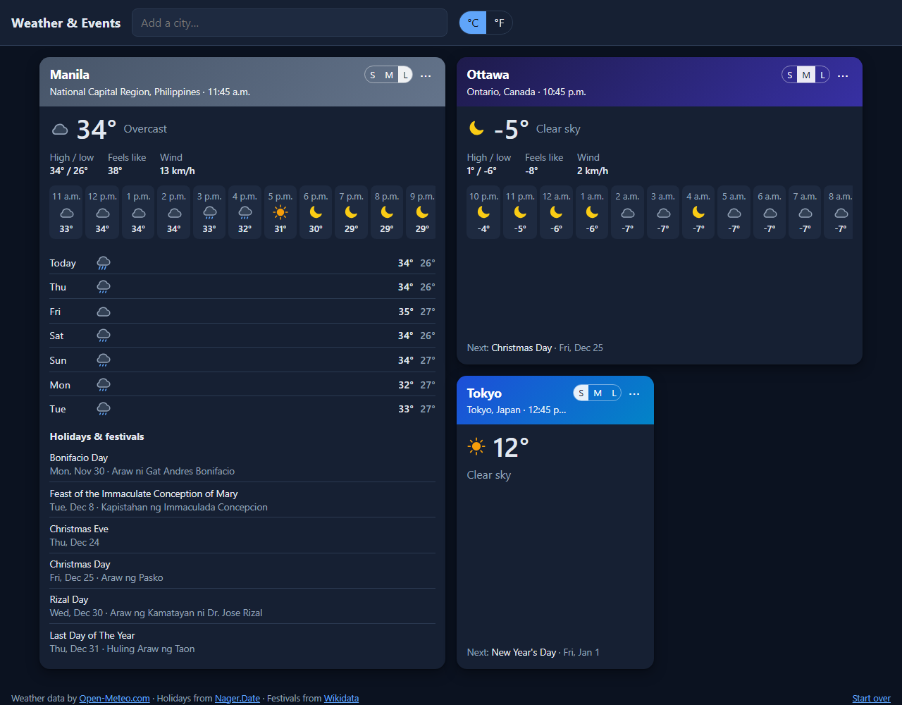
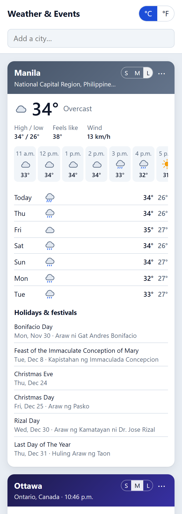

# Weather & Event Dashboard

Search for a city, save it as a favourite, and see its weather, the country's coming public holidays and festivals nearby on a dashboard of cards.

**Live:** https://weather-dashboard-6cof.onrender.com/

> This is a demo on free tiers. After about 15 minutes without visitors the server goes to sleep, so the first visit can take up to a minute. Each browser gets its own private dashboard, started with three sample cities; a dashboard nobody opens for 30 days is removed.

<p>
  
  
</p>

Project 5 of a full-stack practice series. The new skill here is working with third-party APIs: upstream calls that can be slow, rate-limited or fail, a cache in front of them, two sources merged into one answer, and loading and error states for each part of the page. None of the APIs needs a key.

## Features

- City search with suggestions (name, region, country) as you type, then Add. At most 12 cities per dashboard.
- One card per city with current weather and local time. Each card has its own size:
  - **Small:** city, local time, icon, temperature, condition, and the next holiday in one line.
  - **Medium:** adds today's high and low, feels-like, wind, and a strip of the next 12 hours.
  - **Large:** adds the 7-day forecast and the "Holidays & festivals" list.
- Holidays and festivals: the country's next public holidays, with regional ones tagged, plus festivals within 50 km in the coming year, merged by date, at most 6.
- The card's top band is tinted by the weather (clear, cloudy, rain, snow, storm) and by day or night in that city.
- Move a card earlier or later, or remove it, from its menu.
- °C or °F, kept in the browser. The server always works in metric and the browser converts.
- Each part of a card loads and fails on its own: weather and holidays have their own skeleton, error message and Retry button. When an upstream is down, the last answer is shown with its age ("Updated 2 h ago") instead of an empty card.
- One private dashboard per browser, with no accounts. "Start over" in the footer makes a fresh one with the samples.
- Light and dark themes follow the system setting, and the layout works on a phone.

## Stack

| Part | Tools |
| ---- | ----- |
| Language | TypeScript on both sides |
| Client | React 19, Vite |
| Server | Node, Express 5, Zod 4, `helmet`, `express-rate-limit`; Node runs the `.ts` files directly, and `tsc --noEmit` checks them |
| Database | PostgreSQL 18 through Prisma 7 and its `pg` driver adapter; Neon in production |
| Upstreams | [Open-Meteo](https://open-meteo.com/) forecast and geocoding, [Nager.Date](https://date.nager.at/) public holidays, [Wikidata](https://www.wikidata.org/) festivals through its SPARQL endpoint |
| Tests | Vitest and Supertest against a real PostgreSQL with fake upstreams, run in GitHub Actions on every push |
| Hosting | Render free web service, described in `render.yaml`; Express serves the built client |

## Data model

```
Owner 1──* Favourite
```

- **Owner:** one per browser, found by a random key the browser keeps in `localStorage` and sends in the `X-Owner-Key` header. `lastSeenAt` drives the 30-day clean-up.
- **Favourite:** a city from Open-Meteo's geocoding (`placeId`, `name`, `region`, `country`, `countryCode`, `latitude`, `longitude`, `timezone`), plus the user's choices: `size` (`SMALL`, `MEDIUM` or `LARGE`) and `position` (0 first). A city is unique per owner.

Weather, holidays and festivals are **not** stored: they change by the hour and belong to the upstream. Only the user's choices go in the database. Moving a card rewrites the positions for that owner inside one transaction, so two cards never share a place. Deleting an owner removes their favourites through `ON DELETE CASCADE`. The schema is in `server/prisma/schema.prisma`.

## API

Every route except `POST /api/owners` and `GET /api/health` needs the `X-Owner-Key` header.

| Method | Route | Does |
| ------ | ----- | ---- |
| `POST` | `/api/owners` | Make an owner with the sample cities; returns `201` with `{ key }` |
| `GET` | `/api/places?q=` | Up to 8 city suggestions; `q` needs at least 2 characters |
| `GET` | `/api/favourites` | The owner's favourites in order |
| `POST` | `/api/favourites` | Save a place from the suggestions; `201` |
| `PATCH` | `/api/favourites/:id` | Change `size` or `position` |
| `DELETE` | `/api/favourites/:id` | Remove one; `204` |
| `GET` | `/api/weather?lat=&lon=&tz=` | Current weather, the next 12 hours and the next 7 days |
| `GET` | `/api/holidays?lat=&lon=&country=` | Up to 6 holidays and festivals, soonest first; `country` may be empty |
| `GET` | `/api/health` | `200` when the database answers, `503` when it does not |

Weather and holidays answer `{ data, fetchedAt, stale }`, and are separate routes so one failing never blanks the other on a card. Errors are JSON, `{ error: { code, message } }`, and the client picks its message from the code:

| Status | Code | When |
| ------ | ---- | ---- |
| `400` | `bad_request` | Bad input, with `issues: [{ field, message }]` |
| `401` | `unauthorized` | No owner key, or an unknown one |
| `404` | `not_found` | No such favourite for this owner; another owner's favourite answers `404` too, so ids reveal nothing |
| `409` | `duplicate` | The city is already saved |
| `422` | `favourites_full` | The dashboard already has 12 cities |
| `429` | `rate_limited` | Over 10 new owners per hour from one address, or 120 upstream requests per minute from one owner |
| `502` | `upstream_timeout`, `upstream_error`, `upstream_quota` | An upstream failed and nothing usable is cached |

### Upstream calls and the cache

The browser only ever talks to this server. Calling the APIs from the server gives one place to validate, cache and merge, lets many visitors share one upstream call, and lets the server send the User-Agent Wikidata asks every client for.

- Each call has a 5-second timeout (Wikidata 10). A timeout, a network error, a `5xx`, or a response that fails its Zod schema is an upstream failure; a `429` is reported as `upstream_quota`. Nager.Date answers `204` for a country it does not cover, which becomes an empty list.
- The cache in `server/src/cache.ts` keeps each answer with the time it was fetched: weather for 10 minutes; place search, holidays (per country) and festivals (per rounded point) for a day. Past that it fetches again; if that fails and the old answer is under 6 hours old, the old answer is sent with `stale: true`; otherwise the failure goes to the client as `502`.
- Two requests for the same key while a fetch is out share that one fetch, so a dashboard of cards that open at once costs one upstream call per city, not more.
- Coordinates are checked and rounded to 2 decimals (about 1 km) before they become a cache key, so nearby requests share an entry.
- At most 500 entries, oldest dropped first. The cache lives in memory and empties on restart, which is fine on Render's free tier.
- Holidays and festivals are fetched side by side. A holidays failure is a `502`; a festivals failure is logged and the holidays are sent alone, since Wikidata is sparse and rate-limited.

## Environment

| Variable | Used for |
| -------- | -------- |
| `DATABASE_URL` | Required. The database the app queries; Neon's pooled connection string in production |
| `DIRECT_URL` | Neon's direct connection string, used only by migrations |
| `PORT` | Optional, defaults to 3000; Render sets it |

`server/src/env.ts` checks them with Zod once at start-up, so a missing or malformed variable stops the server with a message naming it, not at the first request. The rest of the code imports that result and never reads `process.env`. `server/.env.example` lists every variable; `.env` is never committed. No upstream needs a key.

## Run it locally

Needs Node 26 (pinned in `.node-version`; it runs TypeScript files directly) and PostgreSQL 18.

1. Create a database role, and two databases owned by it: `weather_dev` and `weather_test`. The role needs `CREATEDB`, because `prisma migrate dev` makes a temporary shadow database.

   ```sql
   CREATE ROLE weather LOGIN CREATEDB PASSWORD 'choose-one';
   CREATE DATABASE weather_dev OWNER weather;
   CREATE DATABASE weather_test OWNER weather;
   ```

2. Install, and set up the database addresses:

   ```bash
   git clone https://github.com/Sanbogukai/weather-dashboard.git
   cd weather-dashboard
   cd server && npm install
   cp .env.example .env         # then put your user and password in DATABASE_URL
   cp .env.example .env.test    # same, with weather_test as the database
   npm run migrate
   cd ../client && npm install && cd ..
   ```

3. Then in two terminals:

   ```bash
   cd server && npm run dev    # API on http://localhost:3000
   ```

   ```bash
   cd client && npm run dev    # app on http://localhost:5173, with /api sent to the server
   ```

   If port 3000 is taken, start the server with `PORT=3001` and the client with `API_SERVER=http://localhost:3001`.

### Production build

```bash
cd client && npm run build && cd ../server && npm start
```

Express then serves the API and the app from one address: `/api` first, then the hashed files in `/assets` (cached for a year), then `index.html` for every other page (never cached, so a new deploy shows at once).

## Tests

```bash
cd server && npm test
cd client && npm test
```

The server has 85 tests in 8 files, against the real `weather_test` database. A guard refuses any database whose name does not end in `_test`, and every table is emptied between tests. No test reaches the internet: `createApp()` takes the upstream clients and a clock as options, and the tests pass fakes that answer, hang, fail or return a bad shape. They cover:

- the environment check: a missing `DATABASE_URL` stops start-up with a message naming it;
- the cache: a fresh hit, expiry with the fake clock, a stale answer when the refetch fails, `502` when nothing usable is cached, one upstream call for two requests in flight, and the oldest entry dropped past the limit;
- the upstream clients, against real recorded Open-Meteo, Nager.Date and Wikidata responses in `server/test/fixtures/`: mapping to the shared types, a changed shape as `upstream_error`, a timeout as `upstream_timeout`, a `429` as `upstream_quota`, and Nager.Date's `204`;
- favourites: the samples for a new owner, adding, `409` on a repeat, `422` on the 13th, resizing, moving with positions kept 0 to n−1, deleting, and that one owner can never see, change or delete another's;
- the built client: caching headers, the page fallback, and the security headers.

The client has 22 unit tests for its pure helpers: °C and °F with wind units, date and time formatting, error messages, the weather tint, card order, when a part is due to refresh, and the fetch wrapper that gets and keeps the owner key.

Checks: `npm run typecheck` in `server/` and `client/`. GitHub Actions runs them and the tests against a `postgres:18` service container, plus the client build.

## Deploy notes

`render.yaml` is a Render Blueprint: one free web service in Virginia, next to the Neon database in AWS `us-east-1`, so each query stays in one region. It builds with

```
cd client && npm ci && npm run build && cd ../server && npm ci && npx prisma migrate deploy
```

and starts with `cd server && npm start`. Render deploys a push only after GitHub Actions passes, and sends traffic to a new version only once `/api/health` answers. `DATABASE_URL` and `DIRECT_URL` are entered in Render when the Blueprint is created, never committed. Production is changed only by `prisma migrate deploy`, which applies committed migrations and never resets data.

## Attribution

Weather data by [Open-Meteo.com](https://open-meteo.com/), under CC BY 4.0. Holidays by [Nager.Date](https://date.nager.at/), under the MIT licence. Festivals from [Wikidata](https://www.wikidata.org/), under CC0.
